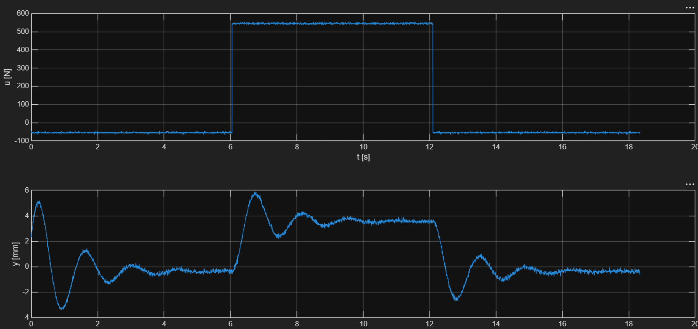
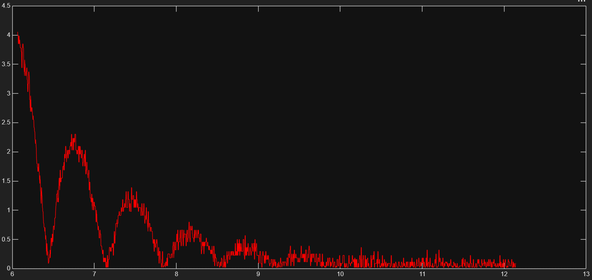
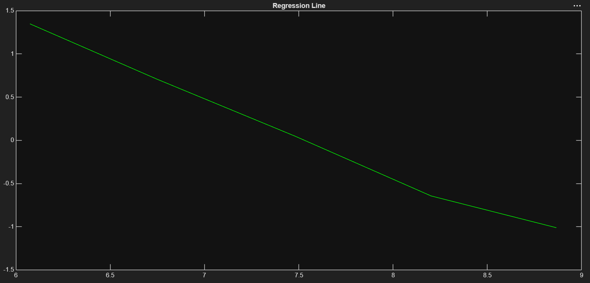
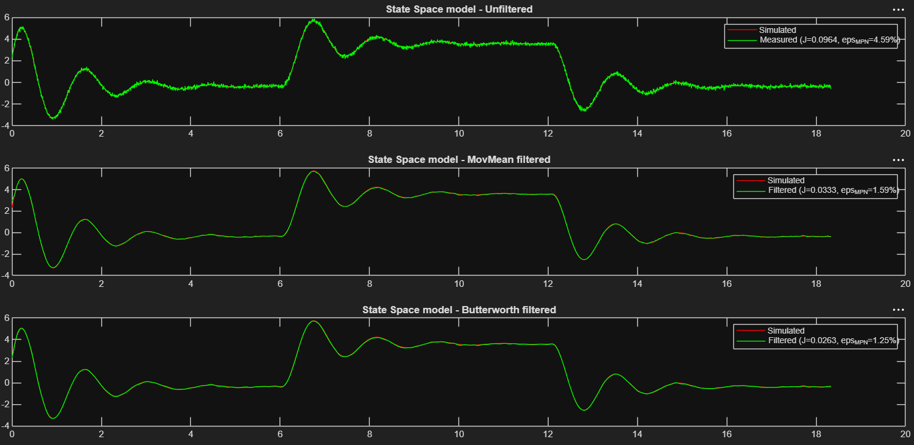
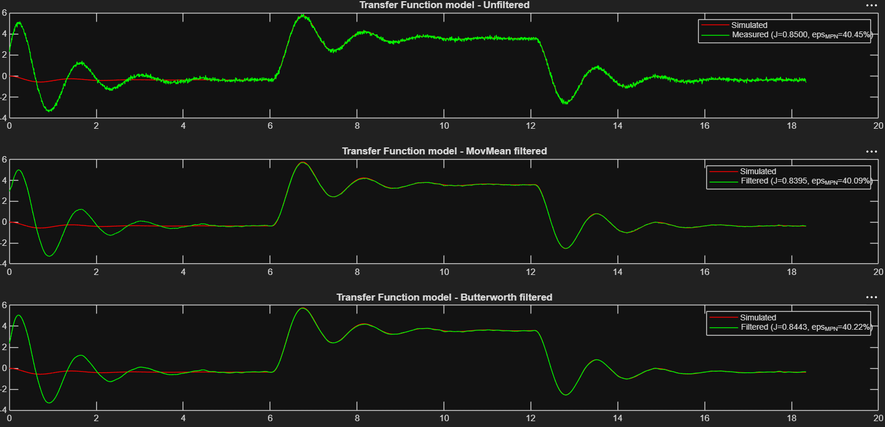

# Identificarea Sistemelor

Proiect pentru disciplina **Identificarea Sistemelor (IS)**. Pe parcursul proiectului sunt aplicate diverse metode de identificare a sistemelor dinamice, pornind de la date experimentale generate prin modele Simulink și procesate în MATLAB. Sistemul studiat poate diferi de la o metodă la alta.

Fiecare metodă de identificare are propria secțiune mai jos, cu fișierele aferente, explicații și rezultate.

---

## Setup și Cerințe

### Cerințe software
- **MATLAB** (testat pe R2023b sau mai recent recomandat)
- **Simulink**
- Toolbox-uri necesare:
  - Control System Toolbox (pentru `ss`, `tf`, `lsim`)
  - Signal Processing Toolbox (pentru `butter`, `filtfilt`, `movmean`)

### Structura fișierelor
Fiecare metodă de identificare are propria pereche de fișiere `.m` / `.slx`, denumite după metodă (nu după sistemul studiat, care poate varia între secțiuni):
```
├── regresie_liniara.m        # Script: generare date, identificare, validare (Metoda 1)
├── regresie_liniara.slx       # Model Simulink asociat (Metoda 1)
├── <metoda_2>.m / .slx         # Următoarea metodă, adăugată pe măsură ce proiectul avansează
├── figs/                       # Grafice rezultate (exportate din MATLAB), referite în README
└── README.md
```

> **Notă:** fișierele generate automat de Simulink la compilare/simulare (`*.slxc`, `slprj/`, etc.) **nu** fac parte din repo — sunt excluse prin `.gitignore`.

### Rulare
1. Deschide MATLAB în folderul proiectului.
2. Rulează scriptul `.m` corespunzător metodei dorite (vezi secțiunile de mai jos).
3. Scriptul apelează automat modelul `.slx` asociat via `sim(...)`, generează date, aplică metoda de identificare și afișează grafice de validare.

### Parametrizare
Scripturile folosesc un identificator `student_id` generat din doi parametri (`m` = numărul grupei, `n` = numărul din listă), folosit ca sămânță pentru generarea reproductibilă a parametrilor sistemului (`rng(...)`) și a zgomotului de măsură/intrare. Aceștia se setează la începutul fiecărui script, în secțiunea `Magic numbers`.

---

## 1. Metoda Regresiei Liniare

**Fișiere:** `regresie_liniara.m`, `regresie_liniara.slx`
**Sistem studiat:** suspensie activă

### Descriere
Această metodă identifică un model de ordinul 2 (state-space / funcție de transfer) al sistemului, pornind de la răspunsul acestuia la o intrare treaptă, folosind regresie liniară pe anvelopa logaritmată a oscilațiilor amortizate.

### Pași de identificare
1. **Achiziție date** — se simulează modelul Simulink cu o intrare tip treaptă (configurabilă prin `u1`, `u2`, `t1`, `t2`), obținându-se semnalele `t`, `u`, `y`.
2. **Verificare saturație** — se verifică dacă intrarea/ieșirea ating limitele de saturație (`umin`/`umax`, `ymin`/`ymax`); în caz afirmativ se afișează un avertisment.
3. **Calcul câștig static (K)** — se determină punctele de echilibru inițial și final (medii pe ferestre de timp fixe) și se calculează câștigul static al sistemului.
4. **Extragerea anvelopei oscilațiilor** — se izolează regiunea de regim tranzitoriu oscilant și se calculează anvelopa (`abs(y - yst)`).
5. **Regresie liniară pe log-anvelopă** — se aplică logaritm pe vârfurile anvelopei și se face o regresie liniară (least squares) pentru a extrage:
   - `alpha` — partea reală a polilor complex-conjugați
   - `wosc` — pulsația de oscilație (din perioada oscilațiilor, `Tosc`)
6. **Calcul parametri model de ordinul 2**:
   - factor de amortizare `zeta`
   - pulsație naturală `wn`
7. **Construire model**:
   - Reprezentare **state-space** (`A`, `B`, `C`, `D`)
   - Reprezentare **funcție de transfer** (`H`)
8. **Filtrare semnal măsurat** (pentru comparație mai curată):
   - Filtru **moving average** (`movmean`)
   - Filtru **Butterworth** trece-jos (ordin 4, `fc = 5 Hz`)
9. **Validare model** — se simulează modelele identificate (`lsim`) și se compară cu semnalul măsurat (brut și filtrat), folosind doi indicatori de performanță:
   - `J` — eroare pătratică medie normalizată (RMSE normalizat la rădăcina numărului de eșantioane)
   - `eps_MPN` — eroare procentuală medie normalizată (Mean Percentage Normalized error)

### Rezultate

Scriptul generează următoarele figuri, prezentate în continuare:

**Date achiziționate** — intrare treaptă `u(t)` și răspunsul sistemului `y(t)`:



**Anvelopa oscilațiilor amortizate**, folosită pentru extragerea parametrilor `alpha` și `wosc`:



**Dreapta de regresie** pe log-anvelopă:



**Validarea modelului state-space** — răspuns simulat (roșu) vs. măsurat (verde), pe semnalul brut și pe cel filtrat (movmean / Butterworth):



**Validarea modelului de tip funcție de transfer** — răspuns simulat (roșu) vs. măsurat (verde), pe semnalul brut și pe cel filtrat (movmean / Butterworth):



Indicatorii de performanță `J` și `eps_MPN` sunt calculați atât pe întregul set de date, cât și doar pe porțiunea de validare (`idx_val`). Modelul de tip funcție de transfer prezintă valori ale erorii semnificativ mai mari decât modelul state-space; cauza este lipsa condițiilor inițiale la apelul `lsim(H,u,t)`, spre deosebire de modelul state-space, unde acestea sunt specificate explicit (a doua condiție inițială — viteza — fiind determinată experimental prin metoda înjumătățirii intervalului). Corectarea acestui aspect va fi tratată într-o versiune ulterioară a scriptului.

---

## 2. *(urmează)*

<!-- Secțiune rezervată pentru următoarea metodă de identificare -->
